### 💼 Experience

**Founder, CEO, CTO and Sole Intern** · jherobred Labs · 2026 to present
> Spearheaded the end-to-end delivery of 8 open-source products with a team of 1. Achieved 100% board approval on every decision (board size: 1). Reduced meeting overhead to zero by never scheduling any.

**Chief Thock Officer** · [TubbyKeys](https://github.com/jherobred/TubbyKeys)
> Brought mechanical keyboard sounds to every Windows laptop, whether the people nearby wanted them or not.

**Head of Offline Intelligence** · [LakbAI](https://github.com/jherobred/LakbAI)
> Put a language model on a phone so OFWs can check their contracts without a signal. Built during a hackathon on very little sleep.

**Student** · University of Santo Tomas
> Learning data structures by day, shipping side projects by night, sleeping during neither.

### 🧰 Stack

   
  

  
  
  
  
  
  

### 🚀 Shipped

| App | What it does | Built with |
|---|---|---|
| [**LodiSave**](https://github.com/jherobred/LodiSave) | Saves images and videos that sites try to block | MV3 extension · Tauri · Kotlin |
| [**Sorro-Productivity**](https://github.com/jherobred/Sorro-Productivity) (WIP) | Productivity app for web, Android and Windows | Next.js · Capacitor · Tauri · Supabase |
| [**LakbAI**](https://github.com/jherobred/LakbAI) | Offline contract checker for OFWs | Flutter · on-device LLM |
| [**KiwiConvert**](https://github.com/jherobred/KiwiConvert) | Shift-drag a file to convert it | Tauri · Rust · FFmpeg |
| [**TubbyKeys**](https://github.com/jherobred/TubbyKeys) | Mechanical keyboard sounds for Windows | Tauri · React · Rust |
| [**SigNull?**](https://github.com/jherobred/SigNull) | Maps your phone signal as you move | Kotlin · Material 3 |
| [**SoundBettrCore**](https://github.com/jherobred/SoundBettrCore) | Per-device EQ for every audio output, plus a hearing test | Tauri · Rust · Kotlin/JNI |
| [**Pane**](https://github.com/jherobred/Windows11-On-Mobile) | Real Windows 11 Arm64 on Android, in one app | Kotlin · QEMU · proot |

### 🐍 Contribution graph, but hungry

<picture>
  <source media="(prefers-color-scheme: dark)" srcset="https://raw.githubusercontent.com/jherobred/jherobred/output/snake-dark.svg">
  
</picture>
